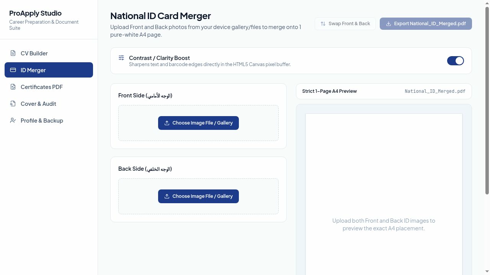

# ProApply Studio

A small toolkit for job applicants: a one-page English CV builder, a National ID card merger (A4 layout), and a certificates PDF bundler.

**Live app:** https://proapply-studio.ai.studio/



This is a personal project, built with AI tools (Google AI Studio) and still under development.

## Features

- ATS-friendly single-page CV builder
- ID card merger for A4 printing
- Certificates bundled into one PDF
- Installable offline web app (PWA)

## Privacy

Everything you enter stays in your own browser. The app has no accounts and does not store your data on a server.

## Run locally

```bash
bun install
bun run dev
```

Copy `.env.example` to `.env` if you need it. Never commit real keys.

## Status

Under development.

## Copyright

Copyright (c) 2026 Abdullah Ayman. All rights reserved.
